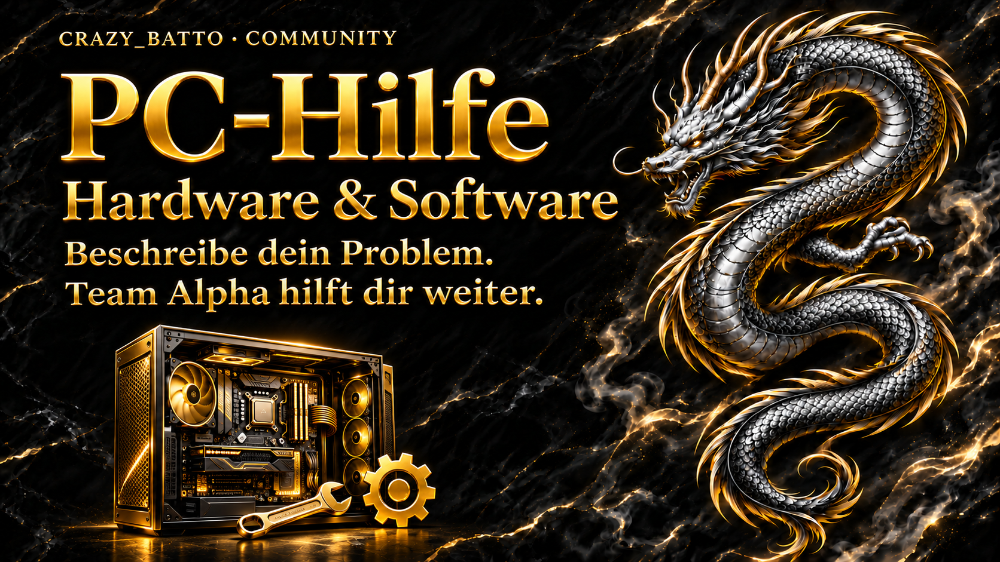

# CRAZY_BATTO · CONTROL CENTER

Ein gemeinsames Verwaltungsprojekt für die CRAZY_BATTO-Website, den Discord-Bot, das Windows-Control-Center und die persönliche Android-Verwaltung. Gestaltung: schwarzer Marmor, Gold und Team-Alpha-Drachenmotive.

Dieses Repository enthält den bereinigten Quellcode. Zugangsdaten, Betreiber- und Serverkennungen, Datenbanken, Mitgliederinhalte, gespeicherte Verbindungen, private Signierschlüssel und fertige Installer/APKs gehören nicht zum Repository. Die eigenen Windows- und Android-Builds werden privat verteilt; der öffentliche Quellcode ermöglicht ausdrücklich keinen Zugang zur bestehenden Verwaltung.

Stand **Control Center 3.7.0** mit **Website-Aufrufen im Desktop** und eigenem **Stream-Deck-Plugin 1.0.0**: Mitgliedermeldungen am PC und Handy prüfen, begründete Maßnahmen bestätigen und neue Meldungen sowie Gaming-Setup-Einreichungen per Push erhalten. Spotify und Bot-Musik lassen sich auch per Stream-Deck-Taste steuern. Die Musik-Sitzung endet, sobald ihr Initiator den Sprachkanal verlässt oder wechselt. Spotify-Verknüpfung und Freigaben bleiben an das angemeldete Konto gebunden.



## Was das Control Center kann

| Bereich | Enthaltene Funktionen |
| --- | --- |
| Einbettungen | Eigene Texte, Bilderlinks, Farben, Vorschau und gezielte Rollen-Erwähnungen; getrennte Einstellungen für allgemeine Nachrichten, Willkommen, Geburtstage, Regeln, Tickets, Meldungen und Gaming-Setups. |
| Willkommen & Rollen | Willkommensnachricht mit Avatar des neuen Mitglieds, automatische Beitrittsrolle, Geräteauswahl für PC/PlayStation/Xbox/Smartphone/Nintendo Switch. King und Moderator werden nicht zur Selbstauswahl angeboten. |
| Beitrittsanfragen | Native Discord-Bewerbungen auflisten, prüfen und annehmen/ablehnen, wenn „Apply to Join“, passende Bot-Rechte und die Discord-API-Vorschau für den Server verfügbar sind. |
| Regeln & Zustimmung | Regel-Einbettung mit Ja-/Nein-Aktion; zustimmungsabhängige Rolle entsprechend der Serverkonfiguration. Goldene Regel- und Ankündigungsbanner liegen bei. |
| TikTok Live | 20 konfigurierbare Creator-Plätze, Zielkanäle und Rollen, Live-Erkennung, Vorschauinformationen/-bilder bei verfügbarer Quelle, Beginn und verstrichene Live-Zeit. |
| Meldungen | Mitglied und Vorfallsart auswählen, Pflichtgrund eingeben, geschützte Fallübersicht am PC und Handy. Einzelne Maßnahmen mit Begründung und Bestätigung: private Abmahnung, Sprachkanal-Stummschaltung aufheben/setzen, Discord-Timeout aufheben/setzen, Kick, Bann und Fallabschluss. Versionsprüfung, Rollenrechte und Maßnahmenverlauf verhindern unbemerkte Doppelentscheidungen; unklare Ergebnisse werden nicht automatisch wiederholt. |
| Sprachkanäle | Aktuelle Teilnehmer anzeigen, serverseitig stumm-/entstummen und die Verbindung trennen, sofern Bot- und Rollenrechte dies erlauben. |
| Tickets | Allgemeine Supporttickets mit Schließfunktion sowie separater PC-Hilfe-Ablauf. |
| PC-Hilfe & Aufträge | Hardware/Software auswählen; Symptome, CPU, GPU, Mainboard, RAM, Betriebssystem, Netzteil und Treiberstand erfassen; geschützte Bildanhänge. Auftragsanfrage mit E-Mail oder Telefon und Preisvorschlag ab 10 €. Annahme/Ablehnung und Preisabstimmung durch den Betreiber. |
| Mitglieder | Website-Registrierungen im Center verwalten. Neue Konten benötigen nach E-Mail-Bestätigung die Admin-Freigabe für geschützte Mitgliederfunktionen. Bereits vorhandene Konten bleiben bei der vorgesehenen Migration freigegeben. |
| Gaming-Setups | Mitglieder reichen Komponenten, Beschreibung und Bilder ein. Erst nach Admin-Freigabe erscheinen Beiträge auf Website und im Discord-Forum; Synchronisation kann erneut angestoßen werden. Eigene Setup-Einbettung und neuer Videokopfbereich mit Standbild und barrierearmer Bewegungssteuerung. |
| Kalender & Events | Geburtstagskalender mit ausdrücklicher Sichtbarkeitsfreigabe, Registrierung über die Website, Geburtstagsnachrichten, Mitgliederzähler und Eventankündigungen mit Ablaufzeit/Countdown. |
| Musik & Medien | Mediathek, Abspiellisten und Bot-Wiedergabe im Sprachkanal. Verlässt der Initiator den Kanal oder wechselt ihn, stoppt der Bot und trennt die Verbindung; er folgt nicht automatisch in einen anderen Kanal. Getrennte Spotify-Anbindung mit Geräteauswahl, Zufall, Wiederholung und Positionssteuerung. |
| Website-Aufrufe | Geschützte Desktop-Übersicht für Gäste-Aufrufe heute, geschätzte Tagesbesucher, 7/30/90-Tage-Verlauf, häufig aufgerufene Seiten und Gesamtaufrufe seit Beginn der Erfassung. Nutzt die bestehende Website-Zählung; angemeldete Konten und erkannte Bots sind ausgeschlossen. Besucherwerte verschiedener Tage sind keine eindeutigen Personen über den gesamten Zeitraum. |
| Stream Deck | Eigenes Plugin für Spotify-Wiedergabe/Geräte/Favoriten, Bot-Musik und alle 33 Control-Center-Bereiche. Lokale, widerrufbare Kopplung; das Center muss auf demselben PC geöffnet sein. |
| Discord-Verwaltung | Server-Icon/Banner, Kanäle, Rollen, Rollenfarben, Bot-Profil, Ereignisse, Protokolle und Einstellungen über die vorhandene serverseitige Bot-Integration. |
| Erweiterte Moderation | Unterstützte Discord-AutoMod-Regeln prüfen und konfigurieren; freigegebene Audiodateien über die vorgesehenen Bot-Aktionen versenden. |
| Verbindungsverwaltung | SFTP-Dateimanager mit lokalen/entfernten Verzeichnissen, Upload/Download und gespeicherten Profilen. Zugangsdaten werden lokal geschützt; der SSH-Hostschlüssel wird geprüft. WinSCP-Import übernimmt freigegebene Verbindungsmetadaten. |
| Lokales Discord | Eigene BetterDiscord-Brücke für kompatible, bereits lokal installierte Erweiterungen und Themen; deren Status und Einstellungen lassen sich im Center verwalten. Fremde Plugins sind nicht mitgeliefert. |
| Android-Control | Persönliche Verwaltungsoberfläche für Mitgliederfreigaben, Meldungen mit Moderation, Gaming-Setup-Prüfung und Support-/Auftragsansichten. Neue Meldungen und Setup-Einreichungen erhalten dauerhafte Benachrichtigungsbelege. Die App bestätigt zunächst, welche Hinweisarten ihr aktiver Hintergrunddienst versteht; bis dahin bleiben neue Hinweise vorgemerkt. Versand- und Entfernungsbelege bleiben auch nach Geräteabmeldung nachvollziehbar. Push-Anmeldung, ausdrückliche Erneuerung veralteter Geräteabos und Testbenachrichtigung; Android-Kanal mit Ton. |
| Robot-SchichtLog | Android-Projekt mit Schicht-/Auftragsaufzeichnungen und Bildern. Optionale Verbindung zum Center zum Prüfen, Nacharbeiten und Löschen synchronisierter Aufträge, einschließlich Konflikt- und Wiederholungsbehandlung. Lokale Daten werden erst nach aktivierter Verbindung synchronisiert. |

## Was von der Einrichtung abhängt

- Die Discord-Oberfläche auf fremden Geräten lässt sich durch den Bot nicht umgestalten. Server-Icon, Banner, Rollen und Nachrichten sind gemeinsam sichtbar; BetterDiscord-Themen betreffen den jeweiligen lokalen Client.
- Ein Kronen-/Gerätesymbol verleiht keine Rechte. Echte Rollen-Icons benötigen eine entsprechende Discord-Serverfunktion; sonst werden Zeichen in Rollennamen und Schaltflächen verwendet. Discord setzt Rollenreihenfolge und Inhabergrenzen durch.
- Beitrittsereignisse benötigen den aktivierten **Server Members Intent**. Weitere Funktionen benötigen die jeweils passenden Bot- und Kanalrechte; sie müssen am eigenen Server geprüft werden.
- Die native Bewerbungsverwaltung verwendet eine Discord-API-Vorschau und setzt „Apply to Join“ voraus. Fehlende Verfügbarkeit wird angezeigt; das Center schaltet diesen Servermodus nicht selbst ein.
- TikTok kann die externe Erkennung oder Vorschau einschränken. Die Integration zeigt verfügbare Daten und kennt Fehler-/Offlinezustände; ein universeller eingebetteter Live-Videoplayer ist nicht zugesichert.
- Ton und Pop-up auf Android hängen von erlaubten Benachrichtigungen, Browser/TWA-Verknüpfung, Benachrichtigungskanal und den Geräteeinstellungen ab. Den Test auf dem eigenen Handy ausführen; ein automatisierter Test ersetzt ihn nicht.
- Nach einem Update die Handyseite neu laden. Eine Geräteanmeldung ist erst aktiv, wenn Browser und Server sie bestätigen. Bei abgelaufenen Browserabos erneuert der ausdrückliche Aktivieren-Klick die Anmeldung; ein bloßer Seitenbesuch meldet kein Gerät automatisch an.
- Externe Konten und Dienste, insbesondere Discord, E-Mail-Anmeldung, Medienablage und optionale Spotify-Anbindung, müssen privat eingerichtet werden. Es sind keine produktiven Konten vorkonfiguriert.
- PC-Aufträge enthalten einen Preisvorschlag und eine Freigabe; dieses Projekt enthält keinen automatischen Zahlungsabzug oder Zahlungsdienst.

## Projektaufbau

```text
desktop/          Electron/React-Desktop-App und Windows-Installer-Konfiguration
streamdeck-plugin/ Eigenes Stream-Deck-Plugin, Einstellungsoberfläche und Tests
server/           Node-Backend, Discord-Bot-Anbindung und Website-Dateien
android-control/  Persönliche Android-Verwaltung mit TWA/Benachrichtigungsdienst
robot-schichtlog/  Robot-SchichtLog-Android-Quellcode
docs/             Einrichtung, Architektur, Daten- und Lizenzhinweise
```

Der vollständige Website-Unterbau ist enthalten, weil Anmeldung, Mediathek, Kalender, Mitgliederprofile und Control Center dieselben Dienste nutzen. Unabhängige fertige Apps und Produkt-PDFs werden nicht als Binärpakete in dieses Repository kopiert.

## Start und Build

Voraussetzungen: Node.js **24.17 oder neuer**, npm; für Windows-Installer Windows. Für Android: JDK 17 oder neuer, Android SDK 35/36 und kompatibles Gradle. Android-Control wurde mit Gradle 8.14.3 geprüft; Robot verwendet Android Gradle Plugin 8.7.3 und SDK 35. Die konkreten Prüfergebnisse stehen in [VALIDATION.md](docs/VALIDATION.md).

```sh
cd server
npm ci
# .env.example privat als .env ausfüllen; siehe docs/INSTALLATION.md
npm test
npm start
```

```sh
cd desktop
npm ci
npm test
npm run build
npm start
# Privaten Windows-Installer bauen:
npm run package
```

Die Android-Ordner lassen sich separat in Android Studio öffnen oder mit `gradle :app:assembleDebug` bauen. Signierte Veröffentlichungen benötigen einen eigenen privaten Signierschlüssel.

Das Stream-Deck-Plugin wird separat aus `streamdeck-plugin/` gebaut; es benötigt Stream Deck ab 7.1 und Control Center ab 3.6.0. Einrichtung, Aktionen und Prüfungen stehen in der [Plugin-Anleitung](streamdeck-plugin/README.md). Fertige Pluginpakete bleiben ebenso wie Installer außerhalb des Repositorys.

Eine Neuinstallation benötigt eigene Bot-/Konto-Konfiguration und eine kontrollierte erste Betreiberfreigabe. Die zufällig wirkenden Discord-Nummern in Tests sind synthetische Beispiele, keine Verbindung zum vorhandenen Server. Siehe [Einrichtung](docs/INSTALLATION.md), [Konfiguration](docs/CONFIGURATION.md), [Architektur](docs/ARCHITECTURE.md) und [Datenschutz & Veröffentlichungsumfang](docs/PUBLICATION.md).

## Rechte und Abhängigkeiten

Dieses Repository erteilt keine pauschale neue Open-Source- oder Markenlizenz für CRAZY_BATTO-, Team-Alpha- oder fremde Inhalte. Abhängigkeiten und vorhandene Fremdassets behalten ihre jeweiligen Lizenzen. Siehe [Drittanbieterhinweise](docs/THIRD_PARTY_NOTICES.md).

